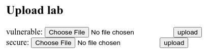
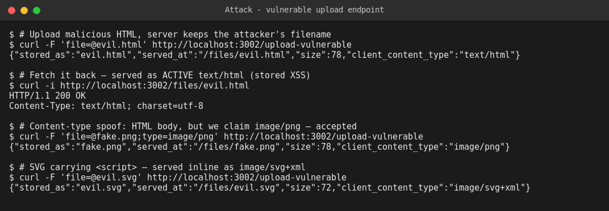
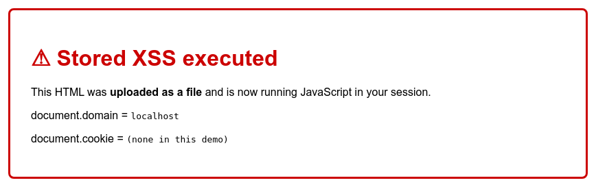
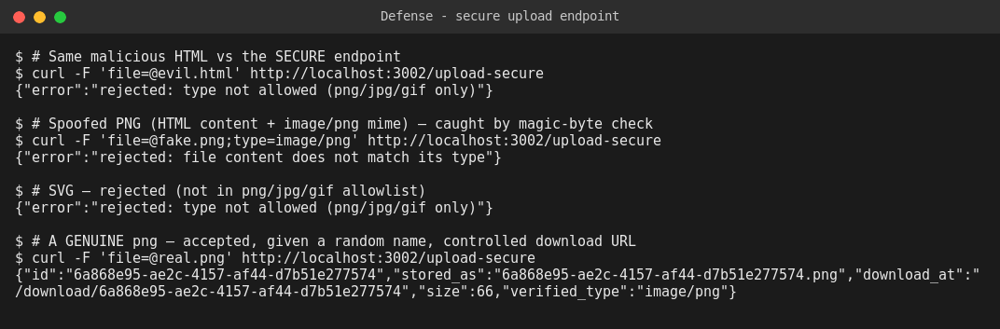

# WEB404 — Secure File Upload: Build, Attack, Secure

**Student:** Pema Tshering Yangchen (2230295) — "Pom"
**Module:** WEB404 (Web Security)
**Assignment:** 3 — *Develop a file upload feature and implement security measures to prevent malicious file uploads.*
**Folder:** `Assignment3/`

---

## Introduction

A file upload feature hands an attacker something unusually powerful: the ability to place a file of their choosing onto the server and, often, to have the server hand it back to other users. If the application trusts what the client says about that file — its name, its extension, its declared content type — then an attacker can upload active content (HTML or SVG carrying JavaScript), disguise it as an innocent image, or manipulate the stored filename. This assignment builds a working upload feature with exactly those weaknesses, demonstrates the resulting attacks against a live server, and then implements a secure upload pipeline — extension and MIME allowlisting, magic-byte content verification, a server-generated random filename, a size limit, storage outside the web root, and a controlled download handler — before replaying the same attacks to confirm each one is now blocked.

---

## Table of Contents

1. [Objective](#1-objective)
2. [Project Structure & File Reference](#2-project-structure--file-reference)
3. [Build Phase — The Vulnerable Upload Feature](#3-build-phase--the-vulnerable-upload-feature)
4. [How to Run](#4-how-to-run)
5. [Attack Phase](#5-attack-phase)
6. [Fix / Secure Phase](#6-fix--secure-phase)
7. [Attack vs Secure — Summary Table](#7-attack-vs-secure--summary-table)
8. [Conclusion](#8-conclusion)

---

## 1. Objective

Develop a file upload feature, demonstrate the attacks that an insecure implementation enables, and implement security measures that prevent malicious uploads. This report covers the **build phase**, the **attack phase**, and the **fix / secure phase**, with evidence captured from a live server.

---

## 2. Project Structure & File Reference

```
Assignment3/
├── upload-lab/
│   ├── app.js                  ← Express server: vulnerable AND secure upload routes
│   ├── package.json
│   ├── uploads-vulnerable/     ← served publicly (dangerous)
│   ├── uploads-secure/         ← OUTSIDE the web root, never served statically
│   ├── attacks/payloads/       ← evil.html, evil.svg, fake.png, real.png, xss-visible.html
│   └── evidence/               ← screenshots captured from live runs
└── README.md                   ← this report
```

| File | Purpose |
|---|---|
| [`app.js`](./upload-lab/app.js) | `/upload-vulnerable` keeps the client filename and serves uploads statically; `/upload-secure` enforces the full secure pipeline. |
| [`attacks/payloads/`](./upload-lab/attacks/payloads/) | The malicious and benign test files used below. |

> **Tech stack:** Node.js + Express 5 + `multer` for multipart handling — the same ecosystem as Assignment 1.

---

## 3. Build Phase — The Vulnerable Upload Feature

The vulnerable endpoint commits the three classic mistakes:

```javascript
const vulnStorage = multer.diskStorage({
  destination: VULN_DIR,
  filename: (req, file, cb) => cb(null, file.originalname), // 1) trusts the client filename
});
const vulnUpload = multer({ storage: vulnStorage });        // 2) no type filter, no size limit

app.use("/files", express.static(VULN_DIR));                // 3) serves uploads as active content
```

1. **No type restriction** — any file is accepted.
2. **Client-supplied filename kept** — enables path/extension control.
3. **Uploads served from a public directory** — so an uploaded `.html`/`.svg` is returned with an active `Content-Type` and runs in the victim's browser.

---

## 4. How to Run

```bash
cd Assignment3/upload-lab
npm install
node app.js            # -> Upload lab running on http://localhost:3002
```
The upload form (for manual testing):



---

## 5. Attack Phase

All evidence below was captured from the running server.

### 5.1 Attack #1 — Upload active content → Stored XSS

A `.html` file containing `<script>` is uploaded and kept under its own name, then served back as `text/html`. When any user opens the link, the script runs **in the application's origin** — a stored cross-site scripting (XSS) vulnerability that can steal sessions, make authenticated requests, or deface the page.



Opening the uploaded file in a browser proves the JavaScript executes:



### 5.2 Attack #2 — Content-type spoofing

The payload `fake.png` **contains HTML** but the request declares `Content-Type: image/png`. The vulnerable endpoint trusts the declared type and stores it — showing that a MIME check alone, based on what the client claims, is worthless.

*(See `fake.png` row in the screenshot above — accepted with `client_content_type:"image/png"`.)*

### 5.3 Attack #3 — SVG with embedded script

SVG is an XML image format that can contain `<script>`. Served inline as `image/svg+xml`, it executes JavaScript — so "it's just an image type" is not safe reasoning. The vulnerable endpoint accepts and serves it.

### 5.4 Attack #4 — Filename / path traversal (and an honest finding)

The payload was uploaded with the filename `../../pwned.txt`, attempting to escape the upload directory and write elsewhere on disk. **It did not escape** — `multer` 2.x reduces `originalname` to its base name, so the file landed inside the upload directory as `pwned.txt`.

> **Viva note (library maturity is a control):** this mirrors the Assignment 1 finding on `jsonwebtoken`. The *application code* here is unsafe — it passes the client filename straight through — but the current library version blocks the traversal by default. The correct conclusion is not "multer makes it safe" but "never rely on that": the secure version below generates its own filename and additionally verifies the resolved path stays inside the target directory, so the defence does not depend on library behaviour that could change.

---

## 6. Fix / Secure Phase

The `/upload-secure` endpoint applies a defence-in-depth pipeline. The vulnerable route is **kept unchanged** for the before/after comparison.

| # | Control | What it stops |
|---|---|---|
| 1 | **Extension + MIME allowlist** (`png`/`jpg`/`gif` only) | Arbitrary types: `.html`, `.svg`, `.php`, executables |
| 2 | **Magic-byte verification** (real bytes must match the claimed type) | Content-type / extension spoofing (`fake.png`) |
| 3 | **Server-generated random filename** (`crypto.randomUUID()`) | Filename/path-traversal control, overwrites, guessable URLs |
| 4 | **Size limit** (1 MB, enforced by multer) | Resource-exhaustion / storage DoS |
| 5 | **Stored outside the web root** (`uploads-secure/`, never `express.static`) | Direct execution/serving of uploaded content |
| 6 | **Controlled download** (forced `Content-Disposition: attachment` + `X-Content-Type-Options: nosniff`) | Inline rendering of any active content; browser MIME-sniffing |

Core of the magic-byte check:

```javascript
const ALLOWED = {
  "image/png":  { ext: ".png", magic: [0x89, 0x50, 0x4e, 0x47] },
  "image/jpeg": { ext: ".jpg", magic: [0xff, 0xd8, 0xff] },
  "image/gif":  { ext: ".gif", magic: [0x47, 0x49, 0x46, 0x38] },
};
// ...after the allowlist passes:
if (!magicMatches(req.file.buffer, rule.magic))
  return res.status(400).json({ error: "rejected: file content does not match its type" });

const safeName = crypto.randomUUID() + rule.ext;   // our name, never the client's
fs.writeFileSync(path.join(SECURE_DIR, safeName), req.file.buffer);
```

### Verification — the same payloads now fail; a real image still works



- `evil.html` → **rejected** (type not in allowlist)
- `fake.png` (HTML body claiming `image/png`) → **rejected by the magic-byte check** — this is the key result: a spoofed MIME type no longer gets through
- `evil.svg` → **rejected**
- `real.png` (a genuine PNG) → **accepted**, stored as a random UUID filename, served only via the controlled `/download/:id` handler

---

## 7. Attack vs Secure — Summary Table

| # | Attack | Root cause | Fix | Verified |
|---|---|---|---|---|
| 1 | Stored XSS via uploaded HTML | Any type accepted; served inline | Allowlist + store outside webroot + forced attachment | `evil.html` rejected |
| 2 | Content-type spoofing | Trusts client-declared MIME | Magic-byte verification of real content | `fake.png` rejected on content |
| 3 | SVG script execution | SVG served inline as image | Allowlist excludes SVG; downloads forced | `evil.svg` rejected |
| 4 | Filename / path traversal | Client filename reused | Server-generated UUID name + resolved-path check | Name is attacker-independent |
| — | Size-based DoS | No size limit | 1 MB `multer` limit | Oversized upload rejected |

---

## 8. Conclusion

Every attack in this assignment came from the same underlying error as the SQL injection work in Assignment 2: **trusting attacker-controlled input** — here, the filename, the extension, and the declared content type that the client attaches to an uploaded file. Because the vulnerable endpoint believed all three, it allowed active content to be stored and served from its own origin (stored XSS), accepted an HTML file wearing an `image/png` label, and reused a filename the attacker chose. The content-type spoofing case is the sharpest lesson: a check based on what the client *says* the file is can always be lied to, so the only reliable check is one based on what the file *actually contains*.

The secure pipeline fixes this not with a single control but with layers, each covering a different failure of trust: an allowlist decides what is even considered; magic-byte inspection confirms the bytes match the claim; a server-generated random name removes all filename control from the attacker; a size limit bounds abuse; storing files outside the web root means an uploaded file is never directly executable or servable; and a forced-download handler with `nosniff` neutralises anything active that slips through. Replaying the identical payloads against the secured endpoint confirmed that the HTML, the SVG, and the spoofed PNG are all rejected while a genuine image is accepted and served safely — closing the vulnerability at its root while preserving the feature's legitimate purpose. The path-traversal result also reinforced an Assignment 1 theme: a current library blocked the attack by default, but the secure design was written so that it does not *depend* on that, since library behaviour is not a security guarantee the application controls.
