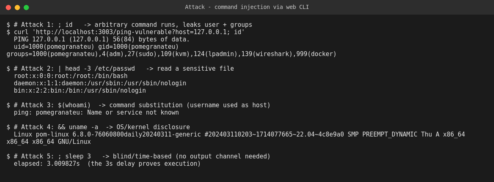
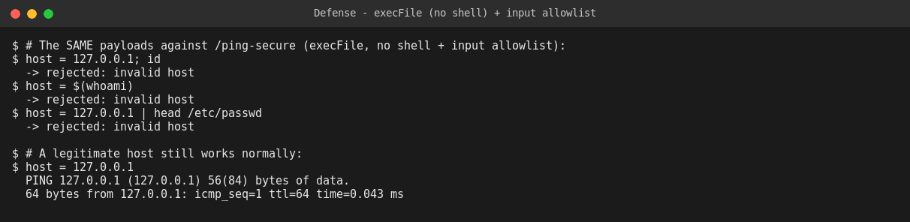

# WEB404 — Command Injection: Build, Attack, Secure

**Student:** Pema Tshering Yangchen (2230295) — "Pom"
**Module:** WEB404 (Web Security)
**Assignment:** 4 — *Create a command-line interface in a web application and implement safeguards against command injection.*
**Folder:** `Assignment4/`

---

## Introduction

Many web applications expose operating-system functionality through a web interface — "network tools" pages that ping a host, DNS lookups, PDF converters, image processors — by shelling out to a command-line program. The danger is that if user input is placed into a shell command string, the shell will happily interpret characters like `;`, `|`, `&&`, and `$(...)` as command *syntax* rather than data, letting an attacker run commands of their own on the server. This assignment builds a web CLI (a ping / host tool) with exactly that flaw, demonstrates several classes of command injection against a live server — command chaining, file disclosure, command substitution, and a blind time-based proof — and then implements the correct safeguards (invoking the program without a shell, plus input validation) and confirms the same payloads are neutralised.

---

## Table of Contents

1. [Objective](#1-objective)
2. [Project Structure & File Reference](#2-project-structure--file-reference)
3. [Build Phase — The Vulnerable Web CLI](#3-build-phase--the-vulnerable-web-cli)
4. [How to Run](#4-how-to-run)
5. [Attack Phase](#5-attack-phase)
6. [Fix / Secure Phase](#6-fix--secure-phase)
7. [Attack vs Secure — Summary Table](#7-attack-vs-secure--summary-table)
8. [Conclusion](#8-conclusion)

---

## 1. Objective

Create a command-line interface in a web application, demonstrate command injection against an insecure implementation, and implement safeguards that prevent it. This report covers the **build**, **attack**, and **fix** phases, with evidence captured from a live server. *(All injected commands used are harmless, read-only diagnostics — `id`, `whoami`, `uname`, `cat`.)*

---

## 2. Project Structure & File Reference

```
Assignment4/
├── cmdi-lab/
│   ├── app.js                 ← Express web CLI: vulnerable AND secure ping routes
│   ├── package.json
│   ├── attacks/run-attacks.sh ← reproduces every attack
│   └── evidence/              ← screenshots captured from live runs
└── README.md                  ← this report
```

| File | Purpose |
|---|---|
| [`app.js`](./cmdi-lab/app.js) | `/ping-vulnerable` builds a shell string with `exec()`; `/ping-secure` uses `execFile()` (no shell) + a hostname allowlist. |
| [`attacks/run-attacks.sh`](./cmdi-lab/attacks/run-attacks.sh) | Runs all attacks, then replays them against the secure route. |

> **Tech stack:** Node.js + Express 5, using the built-in `child_process` module.

---

## 3. Build Phase — The Vulnerable Web CLI

The feature takes a `host` parameter and pings it. The vulnerable version builds a **shell command string**:

```javascript
app.get("/ping-vulnerable", (req, res) => {
  const host = req.query.host ?? "";
  const cmd = `ping -c1 ${host}`;          // <-- root cause: input in a shell string
  exec(cmd, { timeout: 8000 }, (err, stdout, stderr) => {
    res.type("text/plain").send((stdout||"") + (stderr||""));
  });
});
```

`child_process.exec()` runs its argument **through `/bin/sh -c`**. That means every shell metacharacter in `host` is interpreted — which is the entire vulnerability.

---

## 4. How to Run

```bash
cd Assignment4/cmdi-lab
npm install
node app.js            # -> Command-injection lab running on http://localhost:3003

# in a second terminal:
bash attacks/run-attacks.sh
```

---

## 5. Attack Phase

All output below is the real response from the running server.



| # | Type | Payload (`host=`) | Result |
|---|---|---|---|
| 1 | **Command chaining** (`;`) | `127.0.0.1; id` | Runs `id` — leaks the server account and its groups (note: `sudo`, `docker`) |
| 2 | **File disclosure** (`\|`) | `127.0.0.1 \| head -3 /etc/passwd` | Reads `/etc/passwd` |
| 3 | **Command substitution** (`$()`) | `$(whoami)` | `whoami` is executed; its output becomes the host ping tries to resolve |
| 4 | **AND-chaining** (`&&`) | `127.0.0.1 && uname -a` | OS / kernel version disclosure |
| 5 | **Blind / time-based** | `127.0.0.1; sleep 3` | Response takes ~3s — proves execution even with **no visible output** |

**Impact:** command injection is typically the most severe web vulnerability class — it is *remote code execution*. Attack #1 already exposes that the server process is in the `sudo` and `docker` groups, which on a real host would be a direct path to full root compromise. Attack #5 matters because it shows the attacker does not even need the command's output to be shown — a measurable time delay is enough to confirm execution and then exfiltrate data bit by bit.

**Classification:** CWE-78 (OS Command Injection) · OWASP A03:2021 – Injection.

---

## 6. Fix / Secure Phase

The `/ping-secure` route applies two independent safeguards. The vulnerable route is **kept unchanged** for the before/after comparison.

### Fix #1 — Don't use a shell (the core fix)

`execFile()` runs the target program **directly**, passing arguments as a list. No shell is involved, so `;`, `|`, `$()` etc. are never parsed — they are handed to `ping` as a literal, meaningless argument.

```javascript
// SECURE: no shell. The metacharacters are just characters in an argument.
execFile("ping", ["-c1", "--", host], { timeout: 8000 }, (err, stdout, stderr) => {
  res.type("text/plain").send((stdout||"") + (stderr||""));
});
```
The `--` additionally stops a value like `-f` being treated as a ping flag (argument injection).

### Fix #2 — Input validation allowlist (defence in depth)

Before running anything, the input must match a strict hostname / IPv4 pattern; anything else is rejected outright:

```javascript
const HOST_RE = /^(?=.{1,253}$)(?:(?:[a-zA-Z0-9](?:[a-zA-Z0-9-]{0,61}[a-zA-Z0-9])?)\.)*[a-zA-Z0-9](?:[a-zA-Z0-9-]{0,61}[a-zA-Z0-9])?$/;
if (!HOST_RE.test(host)) {
  return res.status(400).type("text/plain").send("rejected: invalid host");
}
```

> **Why both?** Not using a shell is what actually makes injection *impossible*; the allowlist is a second layer that rejects obviously bad input early and keeps the feature's contract tight. Relying on validation alone (e.g. blocklisting `;`) is fragile — attackers find characters you forgot. Removing the shell removes the class of bug.

### Verification — the same payloads now fail; legitimate use still works



- `127.0.0.1; id` → `rejected: invalid host`
- `$(whoami)` → `rejected: invalid host`
- `127.0.0.1 | head /etc/passwd` → `rejected: invalid host`
- `127.0.0.1` → normal ping output

---

## 7. Attack vs Secure — Summary Table

| # | Attack | Root cause | Fix | Verified |
|---|---|---|---|---|
| 1 | Command chaining `;` | Input in a shell string (`exec`) | `execFile` (no shell) + allowlist | `; id` rejected |
| 2 | File disclosure `\|` | Same | Same | pipe rejected |
| 3 | Command substitution `$()` | Same | Same | `$(whoami)` rejected |
| 4 | AND-chaining `&&` | Same | Same | `&&` rejected |
| 5 | Blind / time-based `; sleep` | Same | Same | delay no longer possible |

---

## 8. Conclusion

Command injection in this lab had a single, precise cause: user input was placed into a string that was then handed to a shell, so the shell interpreted the attacker's `;`, `|`, `&&`, and `$()` as commands. The attacks showed just how severe that is — this is remote code execution, not mere data disclosure: a simple `; id` revealed that the server process belonged to the `sudo` and `docker` groups, and the time-based test proved that execution can be confirmed and abused even when the command's output is never displayed back to the attacker.

The fix follows the same principle that runs through this whole set of assignments — keep untrusted input as *data* and never let it become *code*. Here that means not spawning a shell at all: `execFile` passes the host as a literal argument to `ping`, so there is no shell to interpret metacharacters and the injection class simply ceases to exist. An input-validation allowlist is layered on top as defence in depth, but the report is deliberate about the ordering: removing the shell is the real fix, and filtering is the backstop, not the other way around — because blocklisting dangerous characters is a game of catch-up that attackers eventually win. Replaying the identical payloads against the secured endpoint confirmed that all five attacks are rejected while a legitimate host is still pinged normally.
