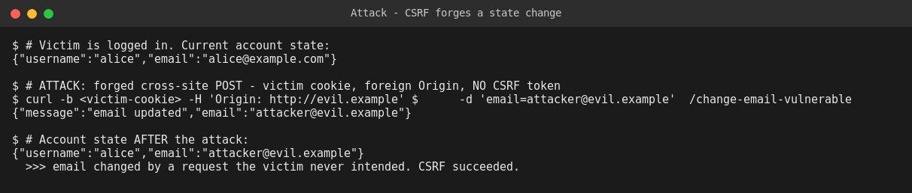
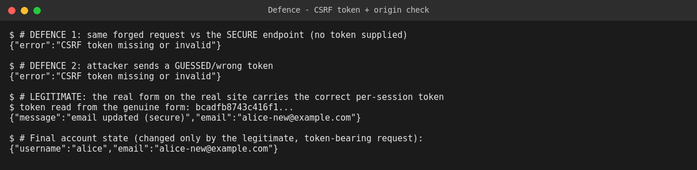

# WEB404 — CSRF: Build, Attack, Secure

**Student:** Pema Tshering Yangchen (2230295) — "Pom"
**Module:** WEB404 (Web Security)
**Assignment:** 5 — *Create a CSRF vulnerable form and then implement CSRF tokens to prevent attacks.*
**Folder:** `Assignment5/`

---

## Introduction

Cross-Site Request Forgery (CSRF) abuses the one thing browsers do automatically: attach a site's cookies to every request to that site, including requests triggered by *other* sites. If a state-changing endpoint decides who you are using only the session cookie, then any page on the internet can submit a hidden form to that endpoint, the browser will attach the victim's cookie, and the action runs *as the victim* — with no theft of credentials and no interaction beyond opening a page. This assignment builds an account app with a CSRF-vulnerable "change email" form, demonstrates a working forgery against a logged-in victim, and then implements the standard defence — the synchronizer **CSRF token** pattern, backed by an Origin check — and verifies the forged request is now rejected while the genuine form still works.

---

## Table of Contents

1. [Objective](#1-objective)
2. [Project Structure & File Reference](#2-project-structure--file-reference)
3. [Build Phase — The Vulnerable Form](#3-build-phase--the-vulnerable-form)
4. [How to Run](#4-how-to-run)
5. [Attack Phase](#5-attack-phase)
6. [Fix / Secure Phase — CSRF Tokens](#6-fix--secure-phase--csrf-tokens)
7. [Attack vs Secure — Summary Table](#7-attack-vs-secure--summary-table)
8. [Conclusion](#8-conclusion)

---

## 1. Objective

Create a CSRF-vulnerable form, demonstrate a cross-site forgery against it, and implement CSRF tokens to prevent the attack. This report covers the **build**, **attack**, and **fix** phases with evidence captured from a live server.

---

## 2. Project Structure & File Reference

```
Assignment5/
├── csrf-lab/
│   ├── app.js                   ← account app: vulnerable AND secure email-change routes
│   ├── package.json
│   ├── attacker/malicious.html  ← the attacker's cross-site exploit page
│   ├── attacks/run-attacks.sh   ← reproduces the attack + defence
│   └── evidence/                ← screenshots captured from live runs
└── README.md                    ← this report
```

| File | Purpose |
|---|---|
| [`app.js`](./csrf-lab/app.js) | `/change-email-vulnerable` trusts the session cookie alone; `/change-email-secure` requires a per-session CSRF token + checks Origin. |
| [`attacker/malicious.html`](./csrf-lab/attacker/malicious.html) | A lure page that auto-submits a forged POST to the vulnerable endpoint. |
| [`attacks/run-attacks.sh`](./csrf-lab/attacks/run-attacks.sh) | Logs a victim in, runs the forgery, then exercises the secure endpoint. |

> **Tech stack:** Node.js + Express 5 + `cookie-parser`, with an in-memory session store.

---

## 3. Build Phase — The Vulnerable Form

The app has a cookie session (set at `/login`) and a state-changing action. The vulnerable endpoint performs the change on the strength of the **session cookie alone**:

```javascript
app.post("/change-email-vulnerable", (req, res) => {
  const ctx = currentUser(req);                 // identifies the user from the sid cookie
  if (!ctx) return res.status(401).json({ error: "not logged in" });
  ctx.user.email = req.body.email;              // no CSRF token, no origin check
  res.json({ message: "email updated", email: ctx.user.email });
});
```

There is no secret in the request that an attacker couldn't also send — so a cross-site request that carries the victim's cookie is indistinguishable from a genuine one.

**The attacker's page** ([`attacker/malicious.html`](./csrf-lab/attacker/malicious.html)) looks like a harmless prize page but auto-submits a hidden form to the target:


```html
<form id="csrf" action="http://localhost:3004/change-email-vulnerable" method="POST">
  <input type="hidden" name="email" value="attacker@evil.example">
</form>
<script>document.getElementById('csrf').submit();</script>
```

> **Note on the session cookie / SameSite (viva depth):** this lab sets the cookie `SameSite=Lax`, not `Strict`, so the vulnerability is kept at the **application layer** — a missing CSRF token — which is what the assignment is about. Modern browsers' `SameSite=Lax` default is itself a partial mitigation (it blocks the cookie on many cross-site POSTs), much like the library-level defaults seen in Assignments 1 and 3. But it is **not** a complete fix: it does not cover every method/navigation, policies vary by browser, and APIs that must allow cross-site use can't rely on it. The CSRF token is the real, server-controlled defence; `SameSite` and the Origin check are additional layers.

---

## 4. How to Run

```bash
cd Assignment5/csrf-lab
npm install
node app.js            # -> CSRF lab running on http://localhost:3004

# in a second terminal:
bash attacks/run-attacks.sh
```

The forgery is reproduced with `curl`, which sends **exactly** what a browser sends on a cross-site form submit: the victim's session cookie, a foreign `Origin`, and no CSRF token.

---

## 5. Attack Phase

A victim (`alice`) is logged in. The attacker's forged request carries her cookie and a foreign Origin but **no CSRF token** — and the vulnerable endpoint accepts it, changing her email to one the attacker controls.



- Before: `alice@example.com`
- Forged POST (`Origin: http://evil.example`, no token) → `"email updated"`
- After: `attacker@evil.example`

**Impact:** the attacker has taken over the account's recovery email without ever knowing the password or stealing the cookie — a direct path to full account takeover (trigger a password reset to the new address). On a banking or admin app the same pattern transfers funds or changes permissions.

**Classification:** CWE-352 (Cross-Site Request Forgery) · OWASP A01:2021 – Broken Access Control.

---

## 6. Fix / Secure Phase — CSRF Tokens

The secure endpoint uses the **synchronizer token pattern**: the server generates a random secret token bound to the session, embeds it in the genuine form, and requires it back on submit. A cross-site attacker **cannot read the token** (the Same-Origin Policy stops them reading the target's page), so they cannot forge a request that contains it.

**Issuing the token in the real form:**
```javascript
app.get("/form-secure", (req, res) => {
  // ...render form with:
  // <input type="hidden" name="_csrf" value="${ctx.sess.csrfToken}">
});
```

**Requiring it on the state change (+ Origin check as a second layer):**
```javascript
app.post("/change-email-secure", (req, res) => {
  const ctx = currentUser(req);
  if (!ctx) return res.status(401).json({ error: "not logged in" });

  // Defence 1 — synchronizer CSRF token must match the session's secret.
  const supplied = req.body._csrf || req.headers["x-csrf-token"];
  if (!supplied || supplied !== ctx.sess.csrfToken)
    return res.status(403).json({ error: "CSRF token missing or invalid" });

  // Defence 2 — reject requests initiated by another origin.
  const origin = req.headers.origin;
  if (origin && !ALLOWED_ORIGINS.has(origin))
    return res.status(403).json({ error: "cross-origin request blocked" });

  ctx.user.email = req.body.email;              // only now is the change applied
  res.json({ message: "email updated (secure)", email: ctx.user.email });
});
```

### Verification — forgery rejected, genuine form still works



| Request | Token | Result |
|---|---|---|
| Forged (attacker page) | none | **403 — CSRF token missing or invalid** |
| Forged with a guessed token | wrong | **403 — CSRF token missing or invalid** |
| Genuine form on the real site | correct per-session token | **200 — email updated (secure)** |

The attacker cannot supply a valid token because they cannot read it; the real user's form always carries it, so legitimate use is unaffected.

---

## 7. Attack vs Secure — Summary Table

| Aspect | Vulnerable | Secure |
|---|---|---|
| Identifies user by | Session cookie only | Session cookie **+** CSRF token |
| Secret the attacker can't forge | — | Per-session random token (unreadable cross-site) |
| Cross-origin requests | Accepted | Rejected (Origin check) |
| Cookie policy | `SameSite=Lax` | `SameSite=Lax` + token (token is the primary control) |
| Forged request result | Email changed | **403 rejected** |
| Genuine request result | Works | Works |

---

## 8. Conclusion

CSRF is unusual among the vulnerabilities in this set because the forged request is, byte for byte, a *valid* request — the flaw is not malformed input but **missing proof of intent**. The vulnerable endpoint authenticated the user (the cookie proved *who* they were) but never authorised the specific action (nothing proved the user actually *meant* to make this change). That gap let an unrelated web page drive a real state change in the victim's account using only the browser's automatic cookie handling, with no credential theft at all.

The CSRF token closes the gap by adding something to every state-changing request that only the genuine page can contain: a per-session secret the server issues and then checks, and that a cross-site attacker cannot read because the Same-Origin Policy forbids reading the target's pages. The Origin check and the `SameSite` cookie attribute are layered on as additional defences, but the report is deliberate that the token is the primary, server-controlled fix — the others are backstops whose behaviour depends on the browser rather than the application. Replaying the forgery against the secured endpoint confirmed it is rejected with a `403`, while the legitimate token-bearing submission still succeeds — proving the action is now gated on genuine user intent, not merely on an authenticated session.
